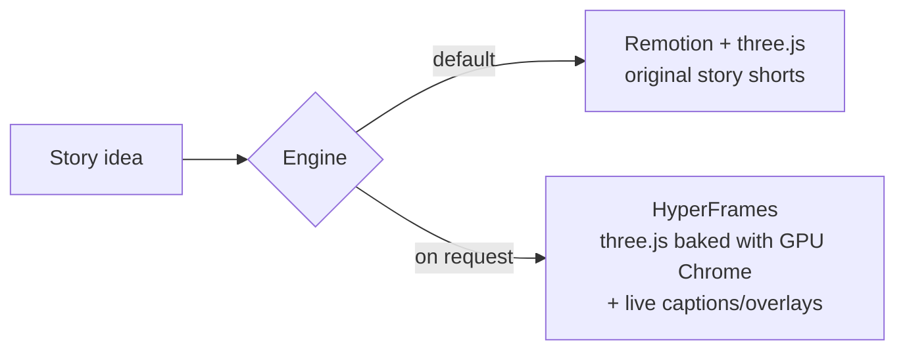

# cartoon-3d-short · Step-by-step workflow

How a 55–70 s vertical cartoon story short goes from idea to final render with the **cartoon-3d-short** skill in Claude Code. The style: flat 2D bean-head characters drawn as cards with ink outlines, inside a painted 3D world with black ink lines, a saturated sky, depth-of-field backgrounds and gliding cameras, plus narration, synthesized sound effects and an original march-style score.

Claude does the work at each step. You pick the story, approve the script and record (or approve) the voice.

## 1. Before your first short (one-time)

| What | Why |
|---|---|
| Node 20+, Python 3, ffmpeg | Build, sound and QA tools |
| A Remotion project with `@remotion/three` | The default engine (the bridge short lives in `src/videos/bridge/`) |
| `npx hyperframes` (optional) | Only for the HyperFrames path (§4) |
| Google Chrome (optional) | Bakes the three.js layer on the GPU for the HyperFrames path |
| A big drive for temp files | Every Remotion bundle copies `public/` (~1.3 GB) into the temp folder and never deletes it. Set `REMOTION_TMP` (or `TEMP`/`TMP` before each render) to a folder on a large drive. |

Start it in Claude Code by asking: *"Use the cartoon short skill and make a short about …"*.

## 2. Pick the engine

- **Remotion (default)** for original story shorts.
- **HyperFrames** when you ask for it. Its own headless capture is too slow for this engine (~40 s per frame), so the 3D layer is baked frame by frame in GPU Chrome (1–5 s per frame) and mounted as a muted video; captions, overlays and audio stay live HyperFrames clips.

## 3. The Remotion pipeline (original shorts)

1. **Topic and facts.** One surprising, *true* story with a visible cause and effect, plus an everyday analogy that explains it. Facts and sources go at the top of `SCRIPT.md`.
2. **Script** (~3.7 words per second, 55–70 s), in this beat order:

    - **Hook:** the absurd fact in one line.
    - **Setting:** year, place, pride.
    - **Action:** escalation over three or four beats, each bigger.
    - **Snap:** the moment it breaks.
    - **Deadpan double line:** "Luckily … / Unluckily …".
    - **Explanation:** one physics idea through an everyday analogy.
    - **Consequence:** the rule it created.
    - **Callback twist:** the ending.
    - Never narrate what the viewer can already see.

    *You approve the script; after that Claude runs to the end.*

3. **Voice.** Record or generate `voice.wav`, transcribe it to word timings (`words.json`) and hand-fix them. Everything is timed to these words.
4. **Shot plan** (`story.ts`). Copy `templates/bridge/` to `src/videos/<name>/` and register a new composition. Then fill the tables:

    | Table | Holds |
    |---|---|
    | `SHOTS` | id, frames, light (day/golden), crowd mode, story time |
    | `CAMS` | camera keys per shot (position, look, FOV, roll) |
    | `XFADE`, `FLASH_AT` | crossfades at place/time changes, the white flash after the hook |
    | `KICKS` | impact shakes |
    | `DOF` / `dofAt` | lens blur per beat |
    | `FOREGROUND` | near framing props |

    Every visual reaction lands 0–3 frames before its word.

5. **World.** Light presets and palette (`lights.ts`), two-tone shading (`shade.ts`), town and props with sight-line culling (`build.ts`), hand-painted textures (`paint.ts`), sky, fog and river (`world.ts`).
6. **Characters.** Drawn with the Canvas2D `Pen` API (`toon.ts`): bean heads, stick limbs, plum outline, a face library. `cast.ts` turns them into camera-facing cards with walk cycles and blinks; `cardshade.ts` lights them with the scene light.
7. **Post** (`Bridge.tsx`): ink → lens blur → bloom → neutral tone map → grade. Every pixel-sized value scales with output height.
8. **Sound** (`templates/audio/`). An event table drives synthesized SFX and an original score ducked under the voice, mixed to an exact-length 48 kHz `mix.wav` with stems. Lock the picture timing before making the sound.
9. **Look checks.** Render stills (`scripts/bridge-stills.mjs`), build side-by-side sheets against your reference frames (`scripts/sbs_sheet.py`), and have a fresh verifier score them.
10. **Final render.** 2K vertical (1440×2560, `--scale 1.3333`), mux the mix in (`-map 0:v:0 -map 1:a:0`), then run `scripts/short_qa.py` for black, white, frozen and pop frames, loudness and contact sheets. Fix what it finds, then a final audit.

## 4. The HyperFrames path

1. **Project:** `npx hyperframes init <dir>`, then copy in `templates/hyperframes/*` and the tools from `templates/scripts/`. Build your world's engine from the `templates/bridge` look modules (ink, lens blur, grade, shading, card shading, paint, `Pen`).
2. **Build:** `cd engine && npm run build` (esbuild → `assets/js/world.js`, driven by HyperFrames seek time).
3. **Look:** serve the folder and make reference-vs-ours sheets from GPU stills or HyperFrames snapshots.
4. **Bake:** `node tools/bake.mjs …` renders each frame in GPU Chrome (incremental), then encode to `assets/world3d.mp4` with ffmpeg.
5. **Composite:** the baked video is one layer; captions and pops are frame-exact GSAP `set()` calls.
6. **Render:** `npx hyperframes check`, stop any preview, `npx hyperframes render`, then the QA script.

## 5. Matching a look (any "make it look like X" pass)

1. **Measure first.** One analysis agent per topic (motion, depth, textures, characters, lighting, outlines, grade), each writing **numbers, not adjectives** to `references/reports/<topic>.md`.
2. **Sandboxes with one owner per file:** camera, world, materials, characters and post each get their own copy and only edit their own files.
3. **Merge** the owned files back (`scripts/bridge_merge.py`), type-check, and re-sync every sandbox.
4. **Verify** with a fresh verifier: side-by-side sheets, a score out of 10 per area and a numbered fix list, routed back to each file's owner.

## 6. Remake mode (only with the owner's permission)

To rebuild an existing clip in this style you need the rights holder's permission, and the result stays private. The method (`references/remake/METHOD.md`, agent prompts in `AGENT_BRIEFS.md`):

1. **Measure:** detect cuts, then three parallel measurement agents (cuts/camera/motion; colour/grade/lighting; depth/texture/characters/ink/captions).
2. **Solve:** gridded key frames → anchors → `templates/remake/fit_layout.py`, a least-squares fit of camera plus character positions, horizon and waterlines (target error < 2 % of frame height); `emit_cams.py` writes the camera keys.
3. **Build** on the HyperFrames path, fixing one area per round.
4. **Verify** each render with a fresh verifier, watch for regressions, then bake, render and QA.

## 7. Where files go

| Folder / file | What's in it |
|---|---|
| `SCRIPT.md` | Facts with sources, then the approved script |
| `voice/` | `voice.wav` and `words.json` |
| `src/videos/<name>/` | The short's code: story, world, characters, post |
| `audio/` | Sound scripts, `mix.wav`, stems, `cues.md` |
| `out/<name>/` | Stills, sheets, QA reports, the final MP4 |

## 8. Quick rules

- Story, characters and voice are always your own. Use reference material for the look, never for content.
- No captions in Remotion shorts; English only; one steady voice tone; jokes are researched real facts.
- Standard mix: music +3 dB, SFX −6 dB, voice unchanged.
- Every hold creeps (no static hold of 4+ frames); impact shakes flip sign every frame and decay over 7 frames.
- Keep film grain off (it bloats the file and the look has none).
- Watch the temp folder: delete old `remotion-webpack-bundle-*` folders when nothing is rendering.

Full detail, look values and gotchas: [`SKILL.md`](../SKILL.md).
